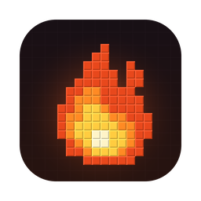

<p align="center"></p>

# Ember

A tiny, fast launcher for Minecraft: Java Edition, built with Tauri.

- Every release and snapshot, plus Beta and Alpha versions, downloaded directly from Mojang
- One-click Fabric, Forge and NeoForge
- **FPS Boost**, on by default: Sodium, Lithium, FerriteCore and more in a separate instance, plus tuned JVM flags
- Correct Java runtime downloaded automatically for each version
- Offline play, with Microsoft account sign-in built in (needs an approved client ID)
- Starts Bedrock Edition on Windows if it's installed

## Download

Get the latest build from [Releases](https://github.com/eymenderdiyok09-dotcom/ember/releases/latest):

| Platform | File |
| --- | --- |
| macOS 11+ (Apple Silicon & Intel) | `Ember_0.1.0_universal.dmg` |
| Windows 10/11 x64 | `Ember_0.1.0_windows-x64.zip` |
| Windows 11 ARM64 | `Ember_0.1.0_windows-arm64.zip` |

The macOS build is signed and notarized. Windows builds aren't signed yet: click **More info → Run anyway**.

## Build

Requires Rust and `cargo install tauri-cli --version "^2"`.

```bash
cd src-tauri
cargo tauri dev                                              # run
cargo tauri build --target universal-apple-darwin --bundles dmg   # macOS
cargo tauri build --target x86_64-pc-windows-gnu --no-bundle     # Windows x64 (needs mingw-w64)
XWIN_CROSS_COMPILER=clang cargo tauri build --runner cargo-xwin \
  --target aarch64-pc-windows-msvc --no-bundle                  # Windows ARM64 (needs cargo-xwin + LLVM)
```

To sign and notarize the macOS build, set `APPLE_SIGNING_IDENTITY="Developer ID Application: …"` for the build, then run `xcrun notarytool submit <dmg> --keychain-profile ember --wait` and `xcrun stapler staple <dmg>`.

To enable Microsoft sign-in, build with `EMBER_MSA_CLIENT_ID=<your Azure app client ID>`.

## Layout

- `src/`: the UI (vanilla HTML, CSS and JS)
- `src-tauri/src/`: game installer, launcher, Microsoft auth, Bedrock (Windows)
- `website/`: the download page, with a live demo of the UI (`website/sync-demo.sh` refreshes it)

---

Not an official Minecraft product. Not approved by or associated with Mojang or Microsoft.
